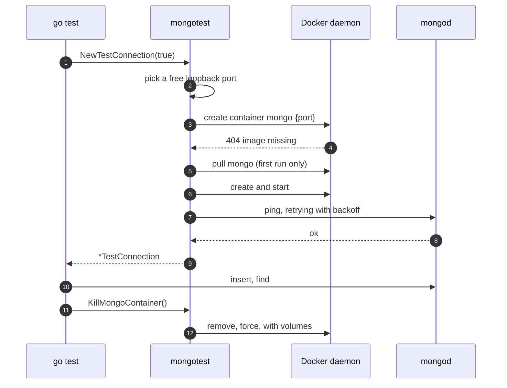

# Quickstart

This page walks through one complete test. By the end you will have a test
that starts a real MongoDB server, inserts a document, reads it back and
leaves nothing behind.

## The whole test

```go title="hero_test.go" linenums="1"
package heroes

import (
    "testing"

    "github.com/stretchr/testify/require"
    "github.com/tophergopher/mongotest"
    "go.mongodb.org/mongo-driver/bson/primitive"
)

type hero struct {
    ID   primitive.ObjectID `bson:"_id"`
    Name string             `bson:"name"`
    City string             `bson:"city"`
}

func TestInsertAndFind(t *testing.T) {
    conn, err := mongotest.NewTestConnection(true)
    require.NoError(t, err, "a mongo container must start before the test can run")
    t.Cleanup(func() { _ = conn.KillMongoContainer() })

    coll := conn.D("heroes").C("roster")

    want := hero{ID: primitive.NewObjectID(), Name: "Diana", City: "Themyscira"}
    _, err = coll.Insert().One(&want)
    require.NoError(t, err, "inserting into a fresh collection must succeed")

    var got hero
    err = coll.Find(primitive.M{"name": "Diana"}).One(&got)
    require.NoError(t, err, "the document just inserted must be found by name")
    require.Equal(t, want, got, "the document must round-trip unchanged")
}
```

Run it:

```sh
go test -run TestInsertAndFind -v .
```

## Line by line

**`mongotest.NewTestConnection(true)`** (line 19) starts a `mongo` container on
a free port on `127.0.0.1`, connects to it and pings until `mongod` answers.
The argument says "use a container". Pass `false` to connect to a server you
are already running on the default port instead.

**`t.Cleanup(...)`** (line 21) registers the teardown. `KillMongoContainer`
force-removes the container and its volumes. `t.Cleanup` runs even when the
test calls `t.Fatal`, which `defer` does too, but `t.Cleanup` also runs after
every subtest has finished, which matters once you add `t.Run`.

**`conn.D("heroes").C("roster")`** (line 23) addresses a database and a
collection. `TestConnection` embeds an
[easymongo](https://github.com/tophergopher/easymongo) connection, so every
easymongo method is available directly on it. If you would rather use the
official driver, `conn.MongoDriverClient()` returns the underlying
`*mongo.Client`.

**The insert and the find** (lines 25 to 32) are ordinary database calls. The
database is empty when the test starts, so the test can assert on exact
contents without clearing anything first.

## Using the official driver instead

Nothing requires easymongo in your own code. Ask for the driver client and
carry on as you would against any server:

```go hl_lines="5"
conn, err := mongotest.NewTestConnection(true)
require.NoError(t, err)
t.Cleanup(func() { _ = conn.KillMongoContainer() })

client := conn.MongoDriverClient()
coll := client.Database("heroes").Collection("roster")
_, err = coll.InsertOne(context.Background(), want)
```

The [one-shot helpers](../guides/one-shot-helpers.md) go further and hand you
a `*mongo.Client` with no `TestConnection` in sight.

## What just happened



[How it works](how-it-works.md) explains each step and the defaults behind it.

## Where next

- Need the same server across a table of cases? See
  [Table-driven and parallel tests](../guides/parallel-tests.md).
- Testing transactions or change streams? Those need a
  [replica set](../guides/replica-sets.md).
- Running in GitHub Actions? The [CI guide](../guides/ci.md) has a working
  workflow.
